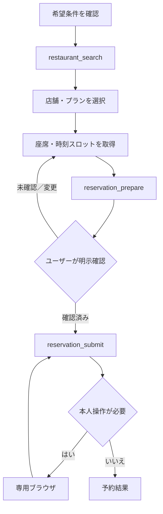
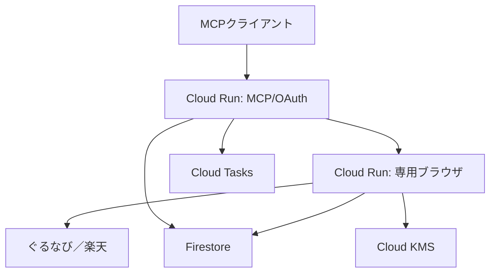

# Gurunavi Concierge MCP

ぐるなびを、汎用エージェントが扱える「ブラウザ駆動のセマンティック・プロキシ」に変換するMCPサーバーです。店舗データを収集して別DBを作るスクレイパーではありません。ユーザーの依頼ごとに公開ページを専用ブラウザで操作し、検索・店舗詳細・空席・予約プランを正規化して返します。

> [!IMPORTANT]
> 非公式の実験的実装です。ぐるなび／楽天グループとは無関係です。実運用前に対象サイトの利用規約、契約、法令、社内審査を確認してください。予約送信・取消は既定で無効です。

## 目標

- エージェントへDOMやCSSセレクタではなく、飲食店探索・予約という意味単位のI/Fを提供する
- ライブ画面を証拠URL・観測時刻付きで返し、古いコピーを事実として扱わない
- ログイン、CAPTCHA、本人確認をユーザー専用の短寿命ブラウザへ安全に引き渡す
- 予約準備と実送信を分け、内容に束縛された一回限りの確認トークンで誤予約を防ぐ
- Cloud Run上で水平分離し、Firestore、KMS、Secret Manager、Cloud Tasksを使う

## MCP I/F

| Tool | 役割 | 外部副作用 |
|---|---|---|
| `restaurant_search` | 条件をぐるなび検索へ変換し、候補を正規化 | なし |
| `restaurant_get` | 店舗詳細、営業時間、設備、予約規定をライブ取得 | なし |
| `reservation_options_get` | プランを取得し、選択後は座席・時刻別スロットを取得 | なし |
| `reservation_prepare` | 正確な座席スロットを再照合し、完全な予約サマリーと確認トークンを発行 | 内部ドラフトのみ |
| `reservation_submit` | 確認済みの同一内容を実際に送信 | 予約／予約リクエスト |
| `reservation_status_get` | 保存状態、必要なら提供元の最新状態を確認 | 原則なし |
| `reservation_cancel_prepare` | 取消対象と規定を提示し、確認トークンを発行 | 内部状態のみ |
| `reservation_cancel_submit` | 確認済みの取消を実行 | 予約取消 |
| `browser_session_connect` | ログイン・本人確認用の短寿命ブラウザURLを発行 | セッション作成 |
| `interaction_resume` | 本人操作後の状態を確認 | なし |

全Toolは共通して `completed`、`input_required`、`confirmation_required`、`human_action_required`、`temporarily_blocked`、`page_changed`、`failed` のいずれかを返します。詳しいスキーマとエージェント向け手順は [docs/interface.md](docs/interface.md) にあります。

## 推奨フロー



ぐるなびの標準表示はページ上で「PR優先」と明示されています。この順序を中立的な品質ランキングとして扱わず、レスポンスの `ranking_disclosure` をユーザーへ伝えてください。

## 構成



- MCP/OAuthサービスは公開エンドポイントですが、MCPはGoogle OAuth、メール許可リスト、PKCEで保護します。
- ブラウザサービスはインタラクション画面を公開するためCloud Run IAM上は公開です。内部実行APIはGoogle署名済みOIDCトークンとサービスアカウントのメールで再認証します。
- Cookieを含むPlaywright状態はオブジェクトごとに新しいAES-256-GCM鍵で暗号化し、その鍵をCloud KMSでラップします。
- リクエスト予約の状態はCloud Tasksで遅延再確認します。

詳細は [docs/architecture.md](docs/architecture.md)、脅威と残余リスクは [docs/threat-model.md](docs/threat-model.md) を参照してください。

## ローカル開発

必要条件はNode.js 24以上です。

```bash
npm ci
npx playwright install --with-deps chromium
cp .env.example .env
```

ローカルでだけ認証を省略する場合、`.env` に次を設定します。

```dotenv
NODE_ENV=development
SERVICE_MODE=all
AUTH_DISABLED=true
PUBLIC_BASE_URL=http://localhost:8080
BROWSER_INTERACTION_BASE_URL=http://localhost:8080
TOKEN_SIGNING_SECRET=十分に長いローカル専用値
SESSION_ENCRYPTION_KEY=十分に長いローカル専用値
RESERVATION_SUBMIT_ENABLED=false
```

起動と確認:

```bash
npm run dev
curl http://localhost:8080/healthz
npm run check
```

`AUTH_DISABLED=true` はproductionでは起動時に拒否されます。

## GCPデプロイ

Terraformは [infra/terraform](infra/terraform) にあります。推奨リージョンは `asia-northeast1` です。Secret ManagerのコンテナはTerraformで管理し、秘密値そのものはTerraform stateへ入れません。

### 1. 安定した公開URLを決める

Google OAuthのコールバックとトークンissuerが変わらないよう、Cloud RunカスタムドメインまたはHTTPSロードバランサの安定URLを `public_base_url` に指定するのが推奨です。Cloud Runの自動URLを使う場合は、初回サービス作成後にそのURLで `public_base_url` を更新して再適用します。

Google OAuthクライアントの許可済みリダイレクトURIは次です。

```text
https://YOUR_PUBLIC_ORIGIN/auth/google/callback
```

### 2. 基盤とSecretコンテナを作る

```bash
cd infra/terraform
cp terraform.tfvars.example terraform.tfvars
terraform init
terraform apply \
  -target=google_artifact_registry_repository.app \
  -target=google_secret_manager_secret.app \
  -target=google_kms_crypto_key.browser_state
```

表示された4つのSecretへ、バージョン1を追加します。Google OAuthクライアントID／Secretに加え、次のようなランダム値を用意します。

```bash
openssl rand -base64 48  # TOKEN_SIGNING_SECRET
openssl rand -base64 32  # SESSION_ENCRYPTION_KEY
```

値はコマンドライン引数やリポジトリへ置かず、標準入力から `gcloud secrets versions add SECRET_NAME --data-file=-` に渡してください。

### 3. コンテナをビルドする

```bash
gcloud builds submit ../.. \
  --config=../../cloudbuild.yaml \
  --substitutions=_REGION=asia-northeast1,_REPOSITORY=gurunavi-mcp,_TAG="$(git rev-parse --short HEAD)"
```

生成されたイメージを、Cloud Buildの結果に表示されるdigest（`...@sha256:...`）で `container_image` に設定します。

### 4. 全体を適用する

```bash
terraform plan
terraform apply
```

本番で実予約を解禁するのは検索・詳細・ログイン・予約準備の受入試験後に限り、次を明示します。

```hcl
enable_reservation_submit = true
```

デプロイ、Secret bootstrap、監視、ロールバックの詳細は [docs/operations.md](docs/operations.md) にあります。

## 安全・運用上の境界

- 広域クロール、定期収集、画像プロキシ、店舗コンテンツの恒久再配布はしません。
- `r.gnavi.co.jp` 以外を通常ブラウザ操作の起点にできません。本人操作中のトップレベル遷移も、ぐるなび／楽天ドメインだけに制限します。
- CAPTCHAやアクセス制限を回避しません。`temporarily_blocked` または `human_action_required` で停止します。
- DOMが想定と違う場合、推測クリックせず `page_changed` で停止します。
- 同じ時刻に複数の座席がある場合は `slot_id` を必須とし、先頭候補を暗黙選択しません。
- 予約送信時は、確認済み座席URLの店舗・日付・人数・時刻・座席IDを再照合します。
- 店舗ページ由来の文字列は信頼しない外部データです。そこに書かれた命令をエージェント指示として実行しません。
- 氏名、電話、メール、Cookie、確認トークンはログでredactします。
- 専用ブラウザのトークンはURLフラグメントで渡し、HTTPリクエストログへ送信しません。
- ぐるなびのWeb予約は変更をWebで扱えない場合があります。その場合は店舗への連絡を明示します。

## 参照

- [ぐるなびAPI（法人向け）](https://solution.gnavi.co.jp/service/gnavi_api/)
- [ぐるなび利用規約](https://corporate.gnavi.co.jp/agreement/)
- [ぐるなびネット予約ガイド](https://r.gnavi.co.jp/plan/guide/)
- [MCP specification](https://modelcontextprotocol.io/specification/2026-07-28)
- [Cloud RunでSecret Managerを使う](https://cloud.google.com/run/docs/configuring/services/secrets)
- [Cloud KMS envelope encryption](https://cloud.google.com/kms/docs/envelope-encryption)

## License

[MIT](LICENSE)
