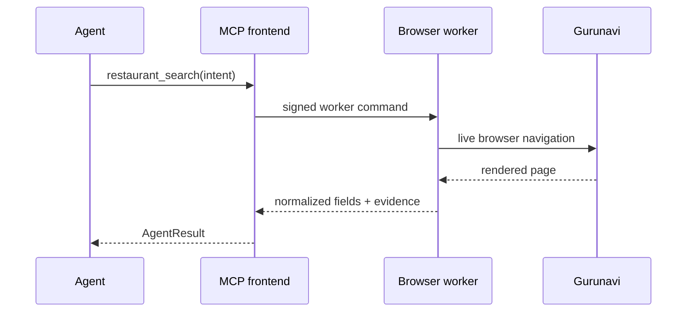
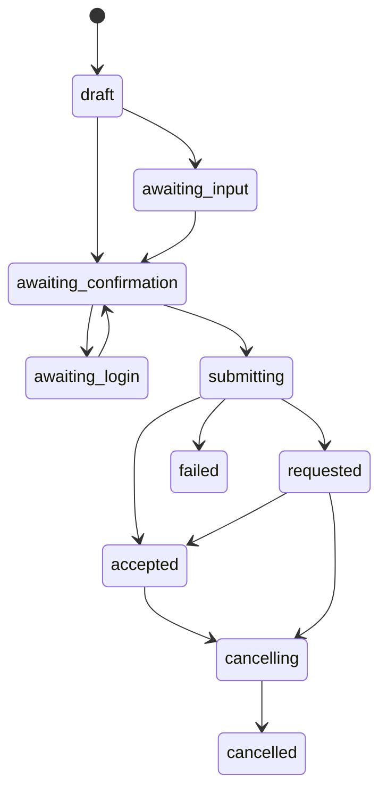

# Architecture

## コンポーネント

### MCP / OAuth frontend

- MCP Streamable HTTPの終端
- OAuth 2.1相当のAuthorization Code + PKCE
- Google OIDCログインとメール許可リスト
- 入力検証、予約状態機械、確認JWT
- Firestore上の短寿命状態
- Cloud Tasksの投入
- ブラウザworkerへのGoogle OIDC認証付き内部呼び出し

### Dedicated browser worker

- Playwright Chromiumを操作ごとに起動
- ぐるなび固有の検索・詳細・予約UIを正規化
- 画像・fontを通常の非対話操作では遮断
- 1プロセス内の最小リクエスト間隔を強制
- 本人操作用WebSocketブラウザ
- KMS envelope encryptionによるセッション保存

同じコンテナイメージを `SERVICE_MODE=mcp` と `SERVICE_MODE=worker` で起動します。ローカルだけは `SERVICE_MODE=all` を使えます。

## リクエスト境界

内部worker APIは discriminated union です。許可されるoperation以外はZodで拒否し、任意URLや任意JavaScriptを受け付けません。

## ブラウザライフサイクル

通常操作ごとに次を行います。

1. process-localのrequest gateを待つ
2. Chromiumを新規起動
3. 必要なら暗号化済みstorage stateを復号
4. `ja-JP`、`Asia/Tokyo` のcontextを作る
5. 許可済みURLへ移動
6. JSON-LDと表示DOMから意味データを抽出
7. 変更がある操作ではstorage stateを再暗号化
8. contextとbrowserを必ず閉じる

ブラウザプロセス自体をFirestoreやCloud Runインスタンス間で持ち回りません。

## URLとDOMの安全境界

- 通常操作のホストは設定された `r.gnavi.co.jp` と完全一致
- スキームはHTTPS
- サブリソースもHTTPSに限定し、localhost、link-local、private IP、GCP metadata hostを遮断
- service workerを無効化し、リクエスト検査の迂回を抑止
- URLのusername/password/hashを除去
- 店舗IDは長さと文字種を制限
- 検索cursorはサーバー定義のbase64url JSONだけを受理
- 予約slot URLはworker内部にだけ保持し、店舗ID・日付・人数・時刻・`tableid`・`courseid`を確認サマリーと照合
- 同時刻の複数座席は安定した `slot_id` で区別し、DOM順に依存しない
- 予約確定・取消ボタンは限定した日本語ラベルで特定
- 成功レシートの表示を認識できない場合、成功扱いにしない
- DOMが不明なら `page_changed`

セレクタのフォールバックはありますが、「それらしい最後のボタン」のような推測操作はしません。

## データ

Firestoreのcollection:

| collection | 内容 | TTL |
|---|---|---|
| `gurunavi_mcp_reservations` | 予約意図、状態、提供元結果 | 予約intentの期限 |
| `gurunavi_mcp_browser_sessions` | 暗号化済みstorage state | セッション期限 |
| `gurunavi_mcp_interactions` | 本人操作の状態 | 15分 |
| `gurunavi_mcp_oauth_clients` | DCRクライアントmetadata | なし |
| `gurunavi_mcp_oauth_requests` | OAuth認可途中状態 | 10分 |
| `gurunavi_mcp_oauth_codes` | 一回限りの認可code | 10分 |

document IDは元キーのSHA-256で、メールやtokenをFirestore document pathへ露出しません。期限付きcollectionにはTerraformでTTL policyを設定します。

予約送信後は、状態照会・取消に不要な氏名、電話、メール、要望を予約recordから削除してから保存期間を延長します。

## KMS envelope encryption

各storage stateの書き込みごとにランダムな256-bit DEKを生成し、AES-256-GCMで暗号化します。DEKはCloud KMSのKEKでwrapし、暗号文・nonce・tag・wrapped DEKだけを保存します。平文DEKは処理後にゼロ化します。

この方式はstorage stateがCloud KMS Encrypt APIの64KiB上限を超えても扱えます。

## 予約状態機械

`reservation_prepare` の結果は15分で失効します。準備後に内容を変更したい場合は、既存トークンを使わず新しいintentを作ります。

## スケーリング

- frontend: concurrency 40、最大3 instanceが既定
- worker: concurrency 1、最大2 instanceが既定
- interactive WebSocketは1接続が1 revision instanceへ固定
- workerのプロセス内rate gateに加え、最大instance数で総並列を制限
- Cloud Tasks queueは1 dispatch/sec、同時2件

サイト負荷や契約条件に合わせて、workerの最大instanceとdispatch rateを上げずに運用するのが既定です。
